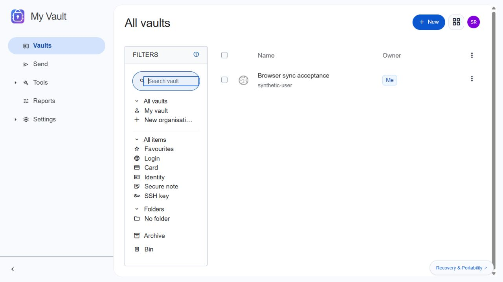
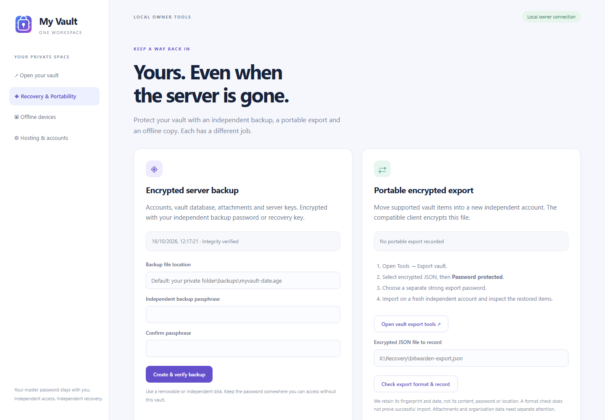

<div align="center">
  
  <h1>My Vault</h1>
  <p>Your passwords. Your server. A way back in without either.</p>
  <p>A Windows companion for Vaultwarden, integrated with One Workspace.</p>
</div>

My Vault packages the established Vaultwarden server and its compatible web vault
with a native Windows launcher and independent recovery tools. Vault passwords
and decryption remain in compatible clients. MyAccounts provides optional sign-in;
it never replaces your vault master password or encryption protection.

When launched from One Workspace, My Vault reuses an active vault session or
automatically starts MyAccounts sign-in. The managed connection can initialize
a verified member's first vault account; choosing the encryption master password
is a one-time client step. See [Sign-in and unlock](docs/SIGN-IN.md) for standalone
configuration, recovery access and current onboarding acceptance limits.





**Release candidate:** browser, MyAccounts sign-in, CLI and server recovery have been exercised with synthetic
data. Remaining client, clean-computer and security review gates are listed in
[acceptance.json](docs/acceptance.json) and [Security review](docs/SECURITY-REVIEW.md).
Do not treat this preview as production ready or store important credentials yet.

**Windows download:** [My Vault 0.2.0 RC3](https://github.com/oneworkspacestudio/my-vault/releases/tag/v0.2.0-rc.3).
It is also included in [One Workspace preview 32](https://github.com/oneworkspacestudio/one-workspace/releases/tag/v0.3.0-preview.32),
with its own app tile, logo, optional MyAccounts connection and recovery guides.

## Start locally

1. Obtain the verified Windows package and check `SHA256SUMS.txt`.
2. Run `MyVault.exe`. Its owner tools and vault bind only to loopback.
3. In the owner tools, explicitly trust the unique localhost certificate for your
   Windows account, then open the secure local vault. The official client requires
   HTTPS even on localhost; no certificate checks are disabled.
4. Open **Hosting & accounts**, select an email and open a ten-minute local
   enrollment. Follow **Create the selected account locally** to choose your
   master password in the compatible client. Close enrollment afterward.
5. Enable compatible MFA, save its recovery code independently, then configure
   backups and test recovery before storing important credentials.

For a chosen portable NTFS location:

```powershell
.\MyVault.exe run --data C:\MyVaultData
```

The single launcher extracts its verified, versioned engine and web assets into
the private data folder. One Go supervisor and one Rust server process run; no
Docker or database installation is required. Data, attachments and backups stay
outside the EXE. Concurrent portable/service launches cannot share the same data
root. Live private data need persistent Windows ACLs; use local NTFS. Encrypted
backups may be placed on exFAT/removable disks.

When installed by One Workspace, its app entry opens the independent vault
address. The app detects the adjacent `workspace-location.json` when launched
directly, so it reuses the same private vault instead of creating a second one.
Run it directly if Workspace or MyAccounts is unavailable. Stop the existing
instance before changing how it is supervised.

## Recovery & Portability

Run `MyVault.exe manage --data YOUR_DATA_FOLDER` on the server. The separate local
owner window displays encrypted-backup date and verification, export format/date,
offline setup, recovery key guidance, schedules and explicit retention controls.
Its access capability is local, transient and absent from public vault pages.

| Safety net | What it preserves | What you need independently |
| --- | --- | --- |
| Encrypted server backup (`.age`) | SQLite, encrypted items, supported attachments, server keys and configuration | Backup passphrase or age secret identity; vault master password and MFA for unlocking |
| Password-protected encrypted Bitwarden JSON export | Supported exported vault items, portable to another account | Export password; independent target account/client |
| Offline client cache | Previously synced local items under supported client conditions | Still-logged-in client, local unlock method and retained client data |

**Account-restricted exports alone are insufficient for disaster recovery.**
Logging out, reinstalling or losing client storage can remove offline access.
The browser web vault is not an offline cache. An archive is not marked integrity
verified until decryption, every file digest and SQLite integrity checks pass.
Account unlock and export/import checks are separate evidence.

See [Recovery](docs/RECOVERY.md), [Clients and format limits](docs/CLIENTS.md),
[Hosting](docs/HOSTING.md), [Administration](docs/ADMIN.md) and the
[threat model](docs/THREAT-MODEL.md).

## Workspace sign-in

The updated Workspace manager connects optional MyAccounts OIDC sign-in
automatically, using a dedicated client on the vault's separate HTTPS origin.
An active MyAccounts session skips another account sign-in. A locked vault still
requires its encryption unlock. Create the independent vault account first and
verify its matching MyAccounts email. Direct email/master-password access and
independent encrypted recovery remain available if MyAccounts is down.
[Sign-in and session details](docs/SIGN-IN.md).

The browser, sign-in and owner tools use My Vault branding with a light,
Material-inspired interface. Upstream JavaScript remains byte-for-byte intact;
the narrow additional script only handles presentation and standard SSO navigation.

## Build and acceptance

Build from the exact [upstream lock](upstream.lock.json) on Windows/MSVC with
bundled SQLite and OpenSSL, then package the verified runtime and compatible web
assets. [Build guide](docs/BUILD.md). No GitHub Actions are used.

This repository tracks actual results in [acceptance.json](docs/acceptance.json).
Mobile work is deferred at the owner's request. Unperformed device, clean-host or
service checks are never represented as passed. Production release eligibility
depends on independent recovery evidence and the documented acceptance matrix.
See [remaining production gates](docs/PRODUCTION-GATES.md); a release candidate
is not evidence that clean-machine, service/reboot or independent review passed.

## Upstream and licensing

Vaultwarden 1.37.4 is AGPL-3.0-only. Its compatible web-vault build is maintained
by `dani-garcia/bw_web_builds`; original client notices are retained. My Vault's
additive branding does not modify the cryptographic JavaScript. Corresponding
source revisions, build scripts and third-party notices accompany distribution.
This is an independent project, not an official Bitwarden product.

- [Vaultwarden source](https://github.com/dani-garcia/vaultwarden/tree/1.37.4)
- [Compatible web build](https://github.com/dani-garcia/bw_web_builds/tree/v2026.7.0)
- [Official encrypted export guidance](https://bitwarden.com/help/encrypted-export/)
- [Official offline guidance](https://bitwarden.com/help/using-bitwarden-offline/)
